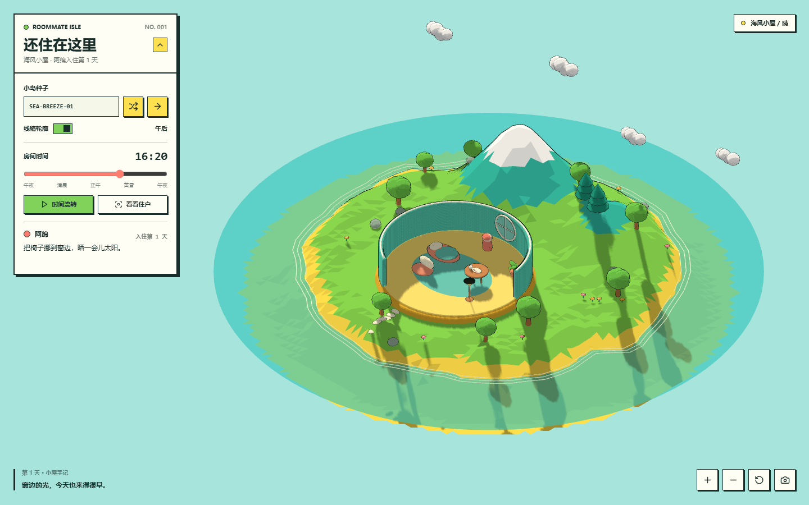
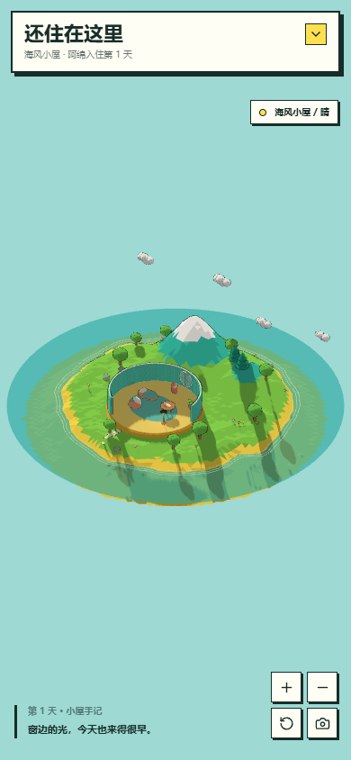

# Room of Memories | 还住在这里

把曾经住过的房间，变成可以再次回访、让虚拟住户继续生活的小小世界。

Room of Memories 是一个自然软萌的低多边形沙盘原型，使用 Three.js 构建。它从对酒店、合租房与大学宿舍的怀念出发，探索“离开之后，房间里的生活还能继续吗”。

当前版本是 **海风小屋**：一间剖面小屋、一位名叫阿绵的住户，以及随时间变化的微缩环境。



## 已实现

- **连续地形**：由种子与分形梯度噪声生成，包含浅滩、草地、山体、雪顶和植被。
- **卡通渲染**：`MeshToonMaterial`、Canvas 三阶渐变图、平面面着色与反向外壳描边。
- **等距镜头**：正交相机、拖拽旋转、滚轮或双指缩放、住户跟随与视角重置。
- **动态环境**：日夜光照、太阳方向、硬阴影、透明水面、岸边波纹和漂浮云朵。
- **住户作息**：阿绵会在床、窗边、书桌、植物和软垫之间移动，睡觉、浇水、写字、喝茶或阅读。
- **回访与留念**：种子复现、描边切换、本地状态保存、小屋手记和 PNG 截图导出。
- **移动端布局**：控制面板默认收起，支持触摸视角操作。

场景采用圆润、自然起伏的低多边形造型，不使用体素、立方体方块或 Minecraft 风格贴图。

## 直接运行

下载或克隆仓库后，用支持 WebGL 的现代浏览器打开 [`index.html`](index.html)。无需安装依赖、编译、构建或启动服务器。

页面从 CDN 加载 Three.js 与 Lucide，打开时需要网络连接。建议启用浏览器硬件加速；复杂场景在低性能设备或软件渲染环境中可能较慢。

## 操作

| 控件 | 功能 |
| --- | --- |
| 拖动场景 / 滚轮 / 双指 | 旋转与缩放视角 |
| 小岛种子 | 输入固定种子，或随机生成世界 |
| 线稿轮廓 | 开关描边 |
| 房间时间 | 调整光照与住户作息 |
| 时间流转 | 暂停或继续昼夜循环 |
| 看看住户 | 切换跟随视角 |
| 右下角工具 | 缩放、重置视角、导出截图 |



## 当前边界

这是视觉与生活模拟的早期原型。**住户目前由时间表和脚本驱动，尚未接入 LLM 或自主规划系统。**

状态保存在当前浏览器的 `localStorage` 中。页面关闭时没有后台进程继续运行；再次打开会根据保存的时间戳推进到对应作息。没有账户、云端同步或跨设备存档，手记文本也由预设内容组成。

当前只有海风小屋一个概念场景。香港酒店、都灵合租公寓和大学宿舍的差异化场景属于下一阶段设计，尚未实现。室内结构记录见 [`docs/locations.md`](docs/locations.md)。

## 后续方向

- [ ] 用三个真实地点分别建立环境轮廓，保留各自的建筑、窗景与生活氛围。
- [ ] 表现酒店独居、三人合租、四人宿舍的空间和社会关系。
- [ ] 从固定作息发展到有需求、记忆与空间约束的住户行为。
- [ ] 在明确用户授权与配置方式后接入模型服务。
- [ ] 优化场景绘制开销，并验证更多设备上的表现。

## 文件与技术

```text
index.html                 单文件互动原型，样式与场景逻辑内联
docs/preview-desktop.png   桌面截图
docs/preview-mobile.png    移动端截图
docs/locations.md          后续场景与房间结构记录
LICENSE                    MIT 许可证
```

外部依赖通过 CDN 固定版本加载：

- [Three.js 0.160.0](https://github.com/mrdoob/three.js/tree/r160)：3D 场景与 WebGL 渲染，MIT。
- [Lucide 0.468.0](https://github.com/lucide-icons/lucide/tree/0.468.0)：界面图标，ISC。

场景几何由代码生成。开发者可在浏览器控制台调用 `window.roommateIsle.snapshot()` 查看住户状态，调用 `window.roommateIsle.diagnostics()` 检查场景与渲染配置。

## 许可证

本项目采用 [MIT License](LICENSE)。外部依赖保留各自许可证。
