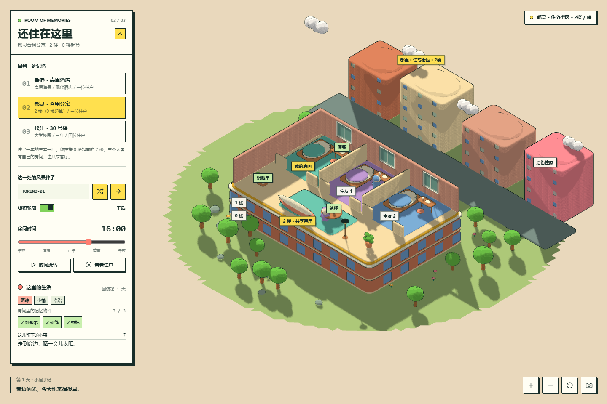
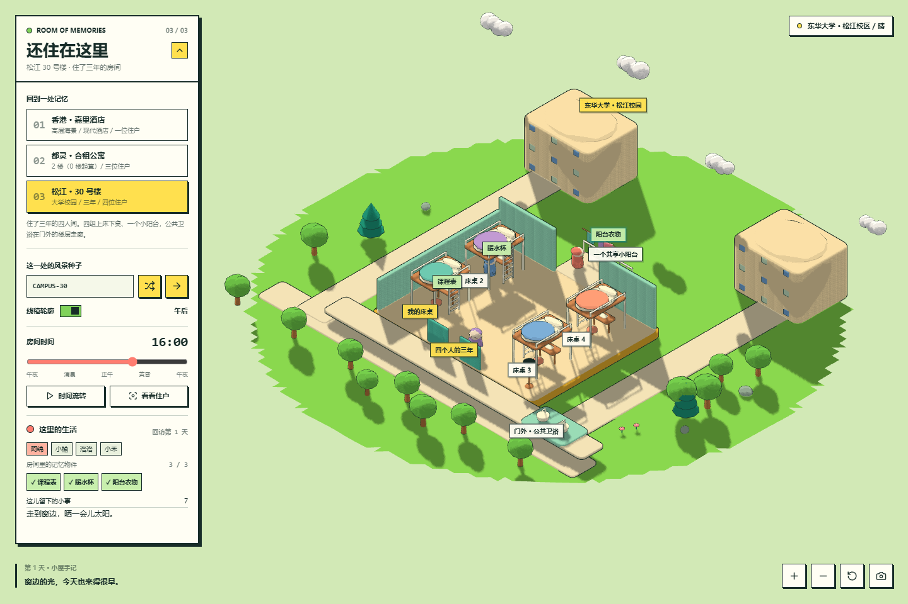
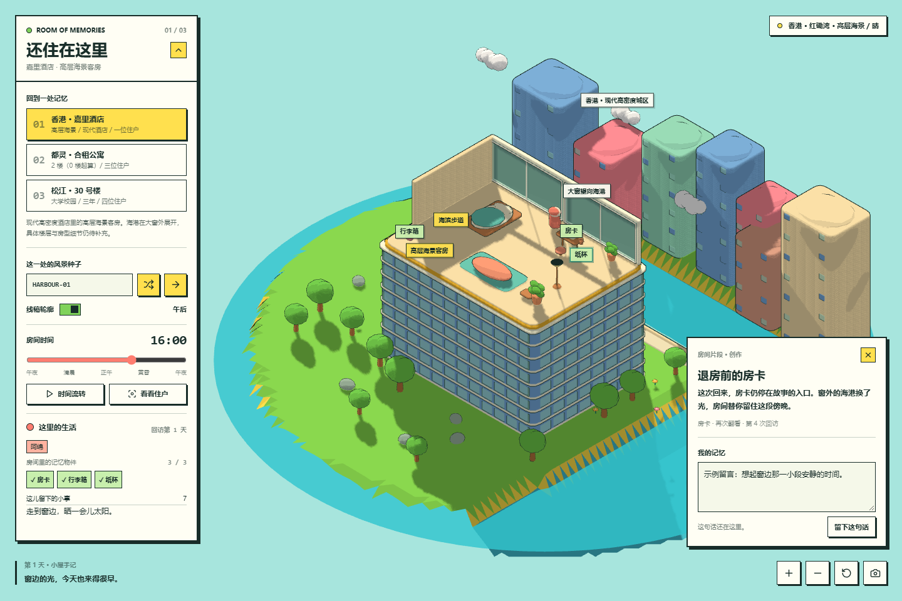
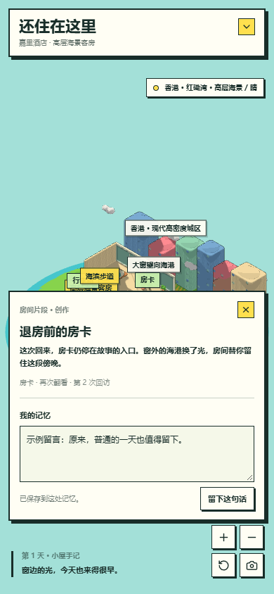

# Room of Memories | 还住在这里

把曾经住过的房间，变成可以再次回访、让虚拟住户继续生活的小小世界。

一个自然软萌的低多边形沙盘原型，使用 Three.js 构建。打开同一份 HTML，在香港海滨酒店、都灵合租公寓与松江大学宿舍之间切换，看看熟悉的光线、个人角落与共享空间。

现在也可以点开房间中的小物件，读一段短故事，给它留下一句话。下次回来，发现过的物件、个人留言与房间里的生活片段还在。


## 三处记忆

| 地点 | 保留的空间关系 | 住户 |
| --- | --- | --- |
| 香港嘉里酒店 | 现代高密度酒店中的高层海景客房、大窗、海港与滨水城市楼群 | 1 位 |
| 都灵合租公寓 | 0 楼起算的 2 楼，下面为 0、1 楼；3 间私人卧室 + 1 个共享客厅 | 3 位 |
| 东华大学松江校区 30 号楼 | 4 组上床下桌 + 1 个共享小阳台 + 房外公共卫浴 | 4 位 |

### 都灵：各自的房间，一起亮着的客厅



### 松江：四个人的三年



这三个场景是根据用户描述建立的**风格化空间示意**。香港已确认高层海景，客房以抬升的室内剖面、大窗和密集楼群表现；都灵的 2 楼按地面为 0 楼计算，也就是从地面数第三层。真实户型、家具、门窗位置与具体窗景仍待补充。香港楼身的楼层带为压缩示意，不代表实际入住楼层或酒店总层数。事实与推断的记录见 [地点记录](docs/locations.md)。

## 一件物品，一小段记忆



| 房间 | 可发现的记忆物件 |
| --- | --- |
| 香港酒店 | 房卡、行李箱、窗边纸杯 |
| 都灵公寓 | 钥匙串、书桌便笺、客厅茶杯 |
| 松江宿舍 | 课程表、暖水杯、阳台衣物 |

第一次打开物件会读到一段创作故事，再次翻看时有不同的短句。你也可以在“我的记忆”里写下自己的话，每件物品最多 600 字。“这儿留下的小事”把个人留言与脚本演绎的生活片段分别标注，随时可以翻看。

房间时间会触发一些小变化：杯子被挪到窗边，便笺换了角度，阳台衣物随风轻动。这些片段来自预设脚本，物件和故事也是可替换的原型创作，不代表真实入住经历。截图中的留言为示例。

## 已实现

- **三处场景切换**：独立的房间构造、周边环境、住户数量和日常活动。
- **自然低多边形地形**：连续分形 Perlin 噪声、非索引平面面着色、圆冠树、针叶树、圆润石块和漂浮云朵。
- **卡通渲染**：全局 `MeshToonMaterial`、Canvas 三阶最近邻渐变图与沿平滑法线膨胀的反向外壳描边。
- **等距镜头**：正交相机、拖拽旋转、滚轮或双指缩放、住户跟随与视角重置。
- **动态光照**：昼夜时间、移动太阳、PCF 硬阴影、夜灯；香港场景另有半透明海水和动态岸边波纹。
- **脚本住户**：在床、书桌、窗边、共享区域等位置之间按预设路点移动。室友作息略有错开，傍晚会在客厅相聚，宿舍洗漱需走到门外。
- **记忆物件**：每处 3 件，共 9 件。可点击三维物品、画面标签或侧栏入口，支持键盘 Enter / Space 打开标签。
- **个人留言与生活记录**：每件物品可以留下自己的话；脚本片段随房间时间出现，部分片段改变物件位置和朝向。同一天的同一片段不会重复记入，最近保留 24 条。
- **分别存档**：每个地点保存自己的种子、时间、回访天数与次数、自动流转状态、最近手记、发现状态和个人留言。
- **互动与留念**：点击任一住户挥手并跟随、描边开关、随机或指定种子、PNG 导出。
- **移动端布局**：窄屏默认收起控制面板，支持触摸旋转与双指缩放。

场景不使用体素、立方体方块、`BoxGeometry` 或 Minecraft 风格纹理。房间与建筑通过圆角挤出轮廓、椭球、圆柱和杆件等几何构造，保留微缩手办的感觉。

## 直接运行

下载或克隆仓库后，用支持 WebGL 的现代浏览器打开 [`index.html`](index.html)。**无需安装依赖、编译或构建。**

页面从 CDN 加载固定版本的 Three.js 与 Lucide，需要联网。建议启用浏览器硬件加速；低性能设备的软件渲染可能较慢。也可以把整个目录放到任意静态服务器上运行。

## 操作

| 控件 | 功能 |
| --- | --- |
| 地点按钮 | 回到酒店、合租公寓或宿舍；恢复该处存档 |
| 拖动 / 滚轮 / 双指 | 旋转与缩放视角 |
| 风景种子 | 输入固定种子，或随机生成当前地点的外部风景 |
| 线稿轮廓 | 开关反向外壳描边 |
| 房间时间 | 调整光照与作息；手动调节会暂停时间 |
| 时间流转 | 暂停或继续昼夜循环 |
| 看看住户 / 点击住户 | 跟随主要住户，或选中的任一室友 |
| 点击记忆物件 / 标签 / 侧栏物件按钮 | 打开故事卡片，翻看并记录个人记忆 |
| 留下这句话 | 保存当前物件的个人留言；清空后保存可删除留言 |
| 这儿留下的小事 | 展开或收起当前地点的个人留言与生活记录 |
| 关闭卡片 / Esc | 保存当前留言并返回房间 |
| 右下角工具 | 缩放、重置视角、导出画面 |




导出的 PNG 只包含三维画布，不含 HTML 控制面板、空间文字标签或手记。README 中的预览图是浏览器页面截图。

## 当前边界

这是视觉与生活模拟原型。**住户由时间表和预设路点驱动，尚未接入 LLM、自主规划或通用碰撞导航。**住户姓名、活动、物件故事、手记和生活片段是虚构内容。用户输入的个人留言单独标注。

状态保存在当前浏览器的 `localStorage` 中，每 5 秒及切换地点时保存。页面关闭后没有后台进程；回访时按保存时间戳补算处于流转状态的地点，暂停的地点保持原时间。演示时间约为 **40 秒 = 1 个房间小时**，不是现实时间同步，也不会生成离线期间每一步活动的完整记录。

存档属于浏览器和页面来源，没有账户或云端同步。移动 HTML 文件、换浏览器或从本地文件改为网站访问时，可能使用不同的存档空间。

个人留言只保存在当前浏览器，不会自动上传到服务器或仓库。点击保存、关闭卡片、切换地点或正常离开页面时，会保存当前留言；刷新后可继续翻看。清除浏览器站点数据会删除这些本地记录。

公开仓库不包含精确租房地址、私人照片或真实室友身份。补充真实户型后，可以继续调整空间布局。

## 文件与技术

```text
index.html                 单文件互动原型，样式与场景逻辑内联
docs/preview-desktop.png   香港场景桌面截图
docs/preview-turin.png     都灵场景桌面截图
docs/preview-dorm.png      宿舍场景桌面截图
docs/preview-mobile.png    移动端截图
docs/preview-memory.png    桌面记忆卡片截图
docs/preview-memory-mobile.png 移动端记忆卡片截图
docs/locations.md          地点事实与示意边界
LICENSE                    MIT 许可证
```

外部依赖通过 CDN 固定版本加载：

- [Three.js 0.160.0](https://github.com/mrdoob/three.js/tree/r160)：3D 与 WebGL 渲染，MIT。
- [Lucide 0.468.0](https://github.com/lucide-icons/lucide/tree/0.468.0)：界面图标，ISC。

开发者可在浏览器控制台调用 `window.roommateIsle.snapshot()` 查看地点、住户活动、手记、记忆物件状态和生活片段，调用 `window.roommateIsle.diagnostics()` 检查实际生成的床桌、房间和记忆物件数量，以及材质、描边、地形指纹和物件坐标有效性。

## 后续方向

- 用用户提供的户型草图与照片细化门窗、家具和真实窗景。
- 增加有需求、记忆和空间约束的住户行为。
- 在明确配置与数据边界后接入模型服务。
- 优化绘制开销并验证更多设备。

## 许可证

本项目采用 [MIT License](LICENSE)。外部依赖保留各自许可证。
